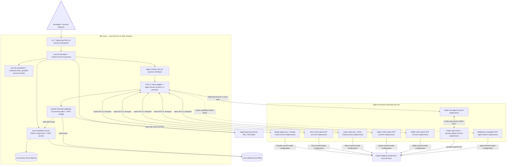

# Bex Security

**Open security workflows for every coding agent and model.**

[](https://github.com/openai/codex-security)
[](https://www.npmjs.com/package/@bex-co/bex-security)
[](https://github.com/agentclientprotocol)
[](LICENSE)

Bex Security is an upstream-first fork of
[OpenAI Codex Security](https://github.com/openai/codex-security). It keeps the
proven workflow for finding, validating, and fixing vulnerabilities while
working toward an open agent layer based on the
[Agent Client Protocol (ACP)](https://github.com/agentclientprotocol/agent-client-protocol).

Our north star is simple: run a consistent, evidence-driven security workflow
with the agent and model that fit your repository, without falling behind
upstream security improvements.

> ⭐ If you want security tooling that is portable across agents, editors, and
> models, star this repository and watch the roadmap.

## Supported Agents

Run the same evidence-driven security workflow with your preferred coding
agent. Codex is the default; Claude Code, Kimi Code, Muse Code, Qwen Code, and
MiMo Code support is currently alpha.

<p>
  <a href="https://github.com/openai/codex"><kbd> Codex</kbd></a> &nbsp;
  <a href="https://code.claude.com/docs/en/overview"><kbd> Claude Code</kbd></a> &nbsp;
  <a href="https://www.kimi.com/code/docs/en/kimi-code-cli/guides/getting-started.html"><kbd> Kimi Code</kbd></a> &nbsp;
  <a href="https://dev.meta.ai/docs/muse-code/"><kbd> Muse Code</kbd></a> &nbsp;
  <a href="https://github.com/QwenLM/qwen-code"><kbd> Qwen Code</kbd></a> &nbsp;
  <a href="https://github.com/XiaomiMiMo/MiMo-Code"><kbd> MiMo Code</kbd></a>
</p>

## Quick start

Requires Node.js 22.13.0+ within 22.x, or Node.js 24.x or 26.x, and Python 3.10+.
Python 3.10 also requires `tomli`.

```bash
npm install --global @bex-co/bex-security
bex-security scan /path/to/repository --agent claude
```

Or run directly without a global installation:

```bash
npx @bex-co/bex-security scan /path/to/repository --agent claude
```

When the scan completes, open the Markdown file at the **REPORT** path in the
terminal. Run `bex-security scans show` from the same repository to find its
latest completed scan again. See [scan scope and follow-up work](sdk/typescript/docs/cli.md#understand-scan-scope-and-follow-up-work)
for how to interpret exclusions in the report.

`bex-security`, `codex-security`, and `cs` run the same CLI. If a name
conflicts with another command, use `bex-security`. If npm reports an `EEXIST`
conflict during a global install, use `npx @bex-co/bex-security` instead.

The published npm package already contains the generated security plugin; the
additional build steps below apply only to a source checkout.

To work from source, clone the repository, install both dependency trees, and
build the bundled plugin and CLI. Building the plugin also needs the universal
native payload in `plugins/codex-security/native/prebuilt`; download it from a
CI run for your commit as described in
[native package inputs](plugins/codex-security/native/README.md#package-inputs).

```bash
git clone https://github.com/bex-co/bex-security.git
cd bex-security
pnpm --dir sdk/typescript install --frozen-lockfile
pnpm --dir plugins/codex-security/mcp-app install --frozen-lockfile
pnpm --dir sdk/typescript run build:plugin
pnpm --dir sdk/typescript run build
./bex-security scan /path/to/repository --agent claude
```

Run `./bex-security` from the checkout, or add the checkout to `PATH` for the
current shell if you prefer the bare command:

```bash
export PATH="$PWD:$PATH"
bex-security --help
```

### Scan options

Choose a scope and scan mode:

```bash
# Scan selected paths.
bex-security scan . --path src --path tests

# Exclude a directory from the scan.
bex-security scan . --exclude-path examples/

# Scan committed changes from a base revision to HEAD.
bex-security scan . --diff origin/main

# Run a deep scan of the repository.
bex-security scan . --mode deep
```

Use `bex-security scan . --max-time 15` for an advisory 15-minute Standard
investigation allowance. See [investigation time](sdk/typescript/docs/cli.md#set-investigation-time)
for timing semantics and Deep Scan limits.

Use `bex-security --help` to browse commands, or `bex-security scan --help`
for scan options, cost limits, and patching after a scan.

For an application spread across repositories, see
[review one system across repositories](sdk/typescript/docs/cli.md#review-one-system-across-repositories).
Use [bulk scans](sdk/typescript/docs/cli.md#bulk-scans) for independent repository
reviews in one resumable campaign.

Scans use existing root and component `SECURITY.md` guidance. To write or
revise it, see [Generate SECURITY.md](#generate-securitymd).

## Why Bex Security

- **Upstream-first, not a rewrite.** Bex uses a repeatable upstream `main`
  merge workflow and treats Codex Security compatibility as a product
  requirement.
- **Agent-open by design.** ACP standardizes communication between code editors
  and coding agents. Bex uses that boundary to support a growing ecosystem
  without building a bespoke integration for every client.
- **Model choice today.** The inherited CLI already supports OpenAI,
  Amazon Bedrock, OpenRouter, Fireworks AI, and Cheaper Inference provider
  paths.
- **Security outcomes over raw output.** The workflow carries findings from
  discovery through validation, remediation, comparison, and publication.

## Features

- Scan repositories, selected paths, or Git changes. Deep scans repeat Standard scans and return their deduplicated findings.
- Validate candidate findings, generate patches, and verify existing fixes.
- Draft `SECURITY.md` policies and save threat models for later review.
- Browse saved scans and findings, identify duplicates, assess severity against
  your own rubric, and suggest owners from source and Git history.
- Preview third-party scanner findings, save them locally, or publish supported reports to Codex Security Cloud. [Scanner import guides](docs/scanner-imports/README.md).
- Track findings in Linear, Jira, or GitHub, publish completed scans, or export SARIF, JSON, and CSV. [Integration workflows](docs/plugin-connectors.md).
- Automate scans across repositories or project components, including in CI and
  containers.

## Project status

Bex Security is an early-stage fork published as `@bex-co/bex-security`. It
preserves the upstream CLI behavior and `codex-security` command alias while
making `bex-security` the primary command. Its first ACP vertical slice runs
Codex sessions through `codex-acp`, and its pluggable agent integrations run
Claude Code through `claude-agent-acp`; Kimi Code, Qwen Code, and MiMo Code
through their native ACP servers; and Muse Code through Bex's community
`muse-code-acp` adapter.

| Capability                                       | Status               |
| ------------------------------------------------ | -------------------- |
| Codex Security-compatible CLI and TypeScript SDK | Available            |
| Multiple inference-provider paths                | Available            |
| Repeatable upstream merge workflow               | Available            |
| Codex sessions over ACP v1 and `codex-acp`       | Alpha                |
| Claude Code sessions over `claude-agent-acp`     | Alpha                |
| Kimi Code sessions over native `kimi acp`        | Alpha                |
| Muse Code sessions over `muse-code-acp`          | Alpha                |
| Qwen Code sessions over native `qwen --acp`      | Alpha                |
| MiMo Code sessions over native `mimo acp`        | Alpha                |
| Kimi models through Claude Code                  | Alpha                |
| Additional ACP agents                            | Contributors welcome |
| Bex-branded CLI (`bex-security`)                 | Available            |
| Bex-branded npm package                          | Available            |

### Target architecture

ACP is an agent-runtime boundary, not a replacement for Bex's security
orchestration or a universal model API. Bex must continue to own scan scope,
workflow selection, permissions, artifact validation, persistence, and final
sealing regardless of which agent executes the work.



The adapter makes Bex the ACP client and selects a small agent driver for
`codex-acp`, `claude-agent-acp`, native `kimi acp`, `muse-code-acp`, native
`qwen --acp`, or native `mimo acp`. Bex
launches the selected agent per turn, negotiates ACP v1, creates or resumes its session, streams
protocol updates into the existing scan observers, forwards cancellation, and
preserves the current noninteractive permission boundary. The agent still owns
model authentication and access; Bex continues to own scan scope, the workflow,
workbench tools, and artifact validation. This keeps the integration small
enough to track upstream while proving that orchestration is independent of one
agent transport.

The adapter boundary is capability-based rather than Codex-shaped. A new agent
must prove that it can run the same scoped workflow and produce artifacts that
pass Bex's existing validation and sealing contract. ACP does not make agents
or model APIs interchangeable by itself.

To make the workflow portable, Bex must extract the security instructions and
schemas from Codex-specific plugin loading into a runtime-neutral workflow pack.
Agent-produced files remain drafts until the Bex workbench validates and seals
them. [`codex-acp`](https://github.com/agentclientprotocol/codex-acp) is a useful
first compatibility target and reference implementation, not a required layer
for every agent.

## Roadmap

1. **Stay current:** continuously merge upstream changes and keep the existing
   CLI, SDK, security controls, and scan artifacts compatible.
2. **Extract the stable host contract:** separate portable prompts, schemas,
   workbench tools, artifact rules, and progress events from Codex plugin
   installation details.
3. **Harden the ACP v1 vertical slice:** expand the Codex and Claude drivers
   from protocol and compatibility tests to repeatable full-scan fixtures,
   structured-output conformance, and interruption tests.
4. **Open the agent port:** add registry agents only when they pass the same
   capability, artifact-contract, and scan-integrity suite.
5. **Expand by evidence:** publish a capability-based compatibility matrix for
   agents and the models they expose. Keep draft ACP v2 support experimental
   until the protocol stabilizes.
6. **Release independently:** publish Bex builds as
   `upstreamVersion-bex.N`, with package metadata recording the exact upstream
   baseline.

Want to help? High-leverage contributions include ACP protocol mapping,
official-schema contract fixtures, agent/model compatibility reports, upstream
regression automation, and concise onboarding examples. Tell us which
[ACP agent](https://github.com/agentclientprotocol/registry) you want Bex to
support first.

## Upstream compatibility

Bex publishes the TypeScript SDK and CLI as `@bex-co/bex-security`. The
`bex-security` command is primary, while `codex-security` and `cs` remain
compatible aliases for existing scripts. Bex releases use `upstreamVersion-bex.N` and record
their upstream package version and commit in npm metadata. See the [upstream
Codex Security documentation](https://learn.chatgpt.com/docs/security/cli) for
the complete CLI reference and
[upstream releases](https://github.com/openai/codex-security/releases) for the
canonical changelog and upgrade notes.

The wrapper forwards every argument to the Bex CLI. The TypeScript package also
exposes `bex-security` as a bin alias while retaining `codex-security` and `cs`
for upstream compatibility.

To use the upstream security workflows from a Codex session with the Codex
Security plugin enabled, see the [agent workflow guide](docs/agent-workflows.md).

Some cybersecurity requests and protected findings require
[Trusted Access for Cyber](https://chatgpt.com/cyber). For accounts with Daybreak
access, see [Daybreak opt-in](sdk/typescript/docs/cli.md#daybreak-opt-in) for the
Codex toggle and [Cyber access programs](sdk/typescript/docs/cli.md#select-a-cyber-access-program)
to select a program explicitly.

## Choose an agent

To scan with Claude Code, authenticate Claude locally and select the Claude ACP
agent:

```bash
./bex-security scan /path/to/repository --agent claude
```

Bex keeps no model allowlist for `--agent claude`: it forwards `--model` and
`--effort` to Claude Code over ACP and validates them against the models and
reasoning levels your local installation advertises. Claude Code exposes its
models as tier aliases rather than versioned ids — a current install offers
`default`, `opus[1m]`, `fable`, `sonnet`, and `haiku`. Select one by alias; for
example, `fable` resolves to your Claude Code's current Fable build (Fable 5.1):

```bash
./bex-security scan /path/to/repository --agent claude --model fable --effort high
```

To pin a specific version behind an alias, export the matching Claude Code
variable (for example `ANTHROPIC_DEFAULT_FABLE_MODEL`) before scanning; the
native `--agent claude` path forwards it to Claude Code unchanged. If Bex
reports that a value is not offered, the local Claude Code does not advertise it
yet — upgrade Claude Code rather than Bex.

To run Claude Code with GLM through Z.AI, provide a Z.AI API key and select the
Z.AI provider:

```bash
export ZAI_API_KEY="<your-zai-api-key>"
./bex-security scan /path/to/repository --agent claude --provider zai
```

This defaults to `glm-5.3[1m]`. Select another GLM model explicitly when
needed:

```bash
./bex-security scan . --agent claude --provider zai --model glm-5.3
```

Bex configures Z.AI only for the Claude ACP subprocess. It does not rewrite
your Claude Code settings or store the API key. See the
[Z.AI Claude Code guide](https://docs.z.ai/devpack/tool/claude) for account and
model availability details.

Kimi is available either as a model provider behind Claude Code or as a native
ACP agent. The Claude provider path uses a Kimi API key and defaults to
`kimi-for-coding`:

```bash
export KIMI_API_KEY="<your-kimi-api-key>"
./bex-security scan . --agent claude --provider kimi
./bex-security scan . --agent claude --provider kimi --model k3-256k
```

For the native path, install Kimi Code, make sure `kimi` is on `PATH`, and log
in once before scanning:

```bash
kimi login
./bex-security scan . --agent kimi
./bex-security scan . --agent kimi --model kimi-code/k3-256k --effort high
```

The native agent uses Kimi Code's saved authentication and provider settings.
Bex starts `kimi acp`, forwards its security workbench over ACP, and reports the
model and thinking level negotiated by Kimi. See the
[Kimi Code installation guide](https://www.kimi.com/code/docs/en/kimi-code-cli/guides/getting-started.html),
[Kimi ACP reference](https://www.kimi.com/code/docs/en/kimi-code-cli/reference/kimi-acp),
and [Kimi Claude Code guide](https://www.kimi.com/code/docs/en/third-party-tools/claude-code.html).

Muse Code is available through the Bex-maintained
[`@bex-co/muse-code-acp`](https://github.com/bex-co/muse-code-acp) adapter.
The adapter ships with Bex Security; install Muse Code and authenticate it once:

```bash
muse login
```

Then select Muse for a scan:

```bash
./bex-security scan . --agent muse
./bex-security scan . --agent muse --model muse-spark-1.2-contributor --effort high
```

Bex forwards its stdio security workbench through ACP. Muse owns model
authentication and configuration. Muse does not expose additional ACP
workspace roots or interactive tool approvals, and usage or cost may be
unavailable when a scan completes. Because Muse does not expose delegated
workers through ACP, Bex automatically runs bounded host-managed review
assignments and advances file coverage only for completed, non-truncated read
operations. Each candidate those assignments report then gets two independent
turns that try to refute it across the repository, and the more skeptical
result informs the final validation. The existing scan command needs no
Muse-specific orchestration flag.

Host-managed reviews save per-attempt requests and outcomes in the scan output
directory. Files that still lack read evidence after every retry do not stop
the scan: the report marks coverage as partial and lists them as deferred work.
Bex keeps a checkpoint of the verified files in its state directory, so running
the same scan again reuses files whose contents have not changed and retries
only the rest; the checkpoint is removed once a scan completes with full
coverage. If assignment review stops on a setup failure, is canceled, or
verifies no file at all, `incomplete-report.md` explains the coverage gap and
links to retained diagnostics and unvalidated candidates.
The scan still fails; this summary is not the validated `report.md`.
See [retained host-review diagnostics](sdk/typescript/README.md#host-review-diagnostics)
for artifact details and output retention.

Qwen Code runs through its native ACP server. Install it, launch `qwen`, and
use `/auth` once to configure a provider before scanning:

```bash
npm install --global @qwen-code/qwen-code@latest
qwen
./bex-security scan . --agent qwen
./bex-security scan . --agent qwen --model qwen3-coder-plus --effort high
```

Bex starts `qwen --acp` and negotiates the models and reasoning levels
advertised by Qwen Code. See the
[Qwen Code quickstart](https://qwenlm.github.io/qwen-code-docs/en/users/quickstart/).

MiMo Code also runs through its native ACP server. Install it and complete its
first-run provider setup before scanning:

```bash
npm install --global @mimo-ai/cli
mimo
./bex-security scan . --agent mimo
./bex-security scan . --agent mimo --model xiaomi/mimo-v2.5-pro --effort high
```

Bex starts `mimo acp` and preserves MiMo's current primary agent mode. MiMo
exposes thinking levels as model variants, so `--effort high` selects the
advertised `.../high` variant of the selected or current model. Bex reports an
error with the available variants when the requested level is unavailable.
See the [MiMo Code repository](https://github.com/XiaomiMiMo/MiMo-Code).

Codex remains the default agent. Sign in with ChatGPT or provide an API key:

```bash
./bex-security login
./bex-security scan /path/to/repository
```

Common scan commands:

```bash
./bex-security scan . --patch
./bex-security scan . --patch --patch-severity high --json
./bex-security scan . --patch --patch-severity high --create-pr
./bex-security scan . --model gpt-5.6-terra --effort high
./bex-security scan . --agent claude
./bex-security scan . --agent claude --provider zai --model glm-5.3
./bex-security scan . --agent claude --provider kimi
./bex-security scan . --agent kimi
./bex-security scan . --agent muse
./bex-security scan . --agent qwen
./bex-security scan . --agent mimo
./bex-security scan . --scan-prompt-file scan.md --post-scan-prompt-file follow-up.md
./bex-security scan . --validation-prompt-file validation.md
./bex-security scan . --mode deep --workers 2 --subagents 0 --stop-after-no-new 3 --max-discovery-runs 10 --max-time 90
```

For CI with Codex, set `OPENAI_API_KEY` or `CODEX_API_KEY` instead of signing
in. `--agent claude` delegates authentication and model discovery to the local
Claude Code installation unless a provider is selected. `--agent kimi`
delegates both to the local Kimi Code installation, `--agent muse` delegates
both to Muse Code through `muse-code-acp`, and `--agent qwen` and `--agent
mimo` delegate both to their respective local installations. The default
remains `--agent codex`; saved scan
recipes created before agent selection also replay with Codex.

Use `--validation-prompt-file` to replace final validation with your own setup,
testing, and cleanup instructions. This works for standard and diff scans;
Deep scans do not support it. See [custom validation](sdk/typescript/docs/cli.md#custom-validation).
For a runnable local example, see the [custom validation demo](examples/custom-validation/README.md).
Environment API keys are passed directly to the current scan and are never
stored in Codex's credential home or system keyring. With `--agent codex`,
`codex-acp` signs its app-server in with the key and keeps that sign-in in
memory, so a saved ChatGPT sign-in stays untouched.

After showing the findings summary, interactive scans with findings ask whether
to open a finding browser where you can inspect full details, choose a severity
threshold, select individual findings, and add patch instructions for each one.
Each selected finding runs in its own saved Codex desktop task.
Use `--patch --patch-severity high` to fix high and critical findings. Add
`--create-pr`, or enable the pull request option during review, to commit the
verified files and open a draft GitHub pull request. Ordinary scans do not
change repository files.

Deep-scan discovery stops after 5760 minutes (96 hours) by default. Set
`--max-time` to any positive number of minutes, including fractional minutes,
up to 5760. Completed findings are preserved and returned when the limit is
reached. `--max-time-hours` remains a deprecated Deep-only alias in hours.

For a monorepo, run separate standard scans and combine their results by root
cause:

```bash
./bex-security scan-components . \
  --component apps/api --component apps/web \
  --output-dir /path/outside/repository/results
```

Use `--auto` to let Codex choose the components, or `--auto --plan-only` to
review the split first. See [component scans](sdk/typescript/docs/cli.md#scan-project-components)
for reusable plans, combined reports, and coverage details.

To use another inference provider, set its API key and select a model:

```bash
export OPENROUTER_API_KEY="<your-openrouter-api-key>"
./bex-security scan . --agent codex --provider openrouter --model anthropic/claude-sonnet-4.5

export FIREWORKS_API_KEY="<your-fireworks-api-key>"
./bex-security scan . --agent codex --provider fireworks --model accounts/fireworks/models/qwen3-235b-a22b

export AWS_BEARER_TOKEN_BEDROCK="<your-bedrock-api-key>"
export AWS_REGION="us-east-2"
./bex-security scan . --agent codex --provider amazon-bedrock --model openai.gpt-5.6-luna
```

Amazon Bedrock also supports standard AWS access keys, profiles, web identity,
container credentials, and the default AWS credential chain.

Local sign-in honors Codex's configured credential backend, including a system
keyring required by a managed device. Bex Security keeps login and scan
credentials in the same private, persistent state directory.

If both a ChatGPT sign-in and an API key are available, interactive scans ask
which credential to use. CI and other noninteractive scans keep the existing
API-key precedence. Select a credential explicitly when needed:

```bash
./bex-security scan . --auth chatgpt
./bex-security scan . --auth api-key
```

To make your ChatGPT sign-in the automatic default, unset any configured API
keys:

```bash
unset OPENAI_API_KEY CODEX_API_KEY
```

Scan history is stored in the Bex Security workbench state directory. If that
directory cannot be written, set `CODEX_SECURITY_STATE_DIR` to a writable
directory outside the repository. Linked Git worktrees share scan history and
saved findings when they use the same state directory. See the
[scan history guide](sdk/typescript/docs/cli.md#scan-history-and-reruns).

Applications can attribute API-key scans to an end user with
`scan --safety-identifier ID` or the SDK's per-run `safetyIdentifier` option.
See [Safety ID setup and runtime requirements](sdk/typescript/docs/cli.md#attribute-scans-to-end-users).

`findings list [repository]` shows open findings across a repository's scans
and identifies findings not confirmed in its latest scan.

Use `patch OCCURRENCE_ID` to fix one saved finding, or
`patch --scan SCAN_ID --severity high` to fix selected findings from a saved
scan. Add `--json` for structured results or `--create-pr` to open a draft
GitHub pull request after verification. If publication fails, use the printed
`patch --resume-pr BRANCH` command to retry without running Codex again.

Use `patch --linear-issue SEC-123` to import and fix a Linear issue, or
`patch --linear-project "Security backlog" --linear-filter '{"labels":{"name":{"eq":"security"}}}'`
to fix matching open issues from a project. Set
`CODEX_SECURITY_LINEAR_API_KEY` to authorize read-only Linear access.

`scans compare BEFORE_SCAN_ID AFTER_SCAN_ID` automatically matches findings by
root cause, reuses saved matches, and identifies new, persisting, reopened,
resolved, or unknown findings. Missing findings remain unknown when coverage is
incomplete or their original location was not reviewed.

## Publish scan findings

Publish every finding from a completed scan to a Linear team:

```bash
./bex-security publish scan /path/to/scan \
  --to linear \
  --linear-team TEAM_ID
```

Add `--linear-project PROJECT_ID` to place the issues in a Linear project, or
omit it to create issues directly in the team. The existing `--project` flag
remains an alias. Omit the scan directory to select a
completed scan interactively. You can also set `CODEX_SECURITY_LINEAR_TEAM` and
the optional `CODEX_SECURITY_LINEAR_PROJECT` instead of passing the destination
flags. Add `--dry-run` to preview the issues or `--json` to return
machine-readable results.

By default, publishing uses your existing Codex sign-in and connected Linear
app without a separate Linear token. To publish directly through the Linear API
instead, set `CODEX_SECURITY_LINEAR_API_KEY` to a Linear personal API key.
Direct publication leaves issues unassigned by default; pass
`--linear-assignee EMAIL_OR_USER_ID` to select a Linear user:

```bash
export CODEX_SECURITY_LINEAR_API_KEY=YOUR_LINEAR_PERSONAL_API_KEY
./bex-security publish scan /path/to/scan \
  --to linear \
  --linear-team TEAM_ID \
  --linear-project PROJECT_ID \
  --linear-assignee teammate@example.com
```

Use `--linear-assignee USER_ID` to select a Linear user ID instead of an email
address, or omit the flag to leave the issues unassigned.

`--linear-api-key KEY` also selects direct publication and takes precedence
over the environment variable. Prefer the environment variable to keep API keys
out of shell history and process listings. Every finding creates a new issue
containing the scan ID, affected code locations, source snippets, and
remediation guidance. Choose a destination authorized to receive the
repository's source code and vulnerability details.

## Verbose diagnostics

Add `--verbose` to print scan diagnostics to stderr:

```bash
./bex-security scan . --verbose
```

`CODEX_SECURITY_LOG_LEVEL=debug` also enables diagnostics;
`LOG_LEVEL=debug` is its fallback. JSON results remain on stdout.

Verbose diagnostics may contain sensitive data. Review local logs before
sharing them. Saved failure summaries, bulk-scan receipts, and the normal
activity feed preserve diagnostic text, including credential-shaped values.

Use `./bex-security scans logs SCAN_ID` to inspect saved session
events from a scan and its workers. Press `d` during a scan to inspect
unredacted details; `a`, `m`, and `1`–`9` select all, main, or worker
sessions. These events can contain credentials.

## Generate SECURITY.md

Use `policy` to draft a new `SECURITY.md` or update an existing one. Use `--path`
to select a component:

```bash
bex-security policy .
bex-security policy . --path services/api --knowledge-base architecture.md
```

The command saves its draft outside the repository and leaves existing files
unchanged. Review the diff and notes, edit the draft, then copy only `SECURITY.md`
to the displayed **Policy target**. Keep the saved architecture and threat-model
documents outside the repository.

Scans already use root and component `SECURITY.md` files. Keep your current policy
if it needs no changes. When updating it, preserve its vulnerability-reporting
instructions. If the command says the policy is already up to date, no copy is
needed.

Files at `.github/SECURITY.md` or `docs/SECURITY.md` often contain reporting
instructions. Preserve them when drafting a policy; those locations do not
automatically provide repository-wide scan guidance. See the
[policy guide](sdk/typescript/docs/cli.md#generate-a-security-policy) for policy
locations, unanswered questions, saved artifacts, and SDK usage.

## TypeScript SDK

Install the package locally in your TypeScript project:

```bash
npm install @bex-co/bex-security
```

Then import it:

```ts
import { CodexSecurity } from "@bex-co/bex-security";

const security = new CodexSecurity();

try {
  const result = await security.run("/path/to/repository");
  console.log(result.reportPath);
} finally {
  await security.close();
}
```

Pass `new CodexSecurity({ agent: "claude" })` to select another ACP agent; see
the [package README](sdk/typescript/README.md#select-an-agent-from-typescript).
The [SDK guide](sdk/typescript/docs/sdk.md) includes deep-scan configuration,
validation, severity classification, owner suggestions, and result handling.

## Read existing Cloud findings

When Codex Security Cloud is available to your account, the Security plugin's
`$cloud-findings` skill can read findings, reports, recorded assignment and
verification, and scan status in Codex desktop or the Codex CLI. Cloud is an
optional connection; local scans work without it.

See [Cloud connection setup and CLI reads](sdk/typescript/docs/sdk.md#read-existing-cloud-findings)
for authentication requirements and a read-only example.

## Save and export threat models

Scans and policy generation save threat models with their results. Export a saved
model without starting another analysis:

```bash
bex-security export --scan SCAN_ID --artifact threat-model --output threatmodel.md
```

Omit `--scan` to use the current repository's latest completed scan. The
[export guide](sdk/typescript/docs/cli.md#exports-and-ci) also covers findings,
SARIF output for CI, and the offline TypeScript API. For ServiceNow Application
Vulnerability Response, see [Export findings for ServiceNow](sdk/typescript/docs/cli.md#export-findings-for-servicenow).

## Containerized bulk scans

Scan a list of repositories with the included Docker Compose configuration,
which keeps results and authentication between runs. Repositories are pinned to
immutable Git revisions. See the
[container quick start](sdk/typescript/docs/cli.md#containerized-bulk-scans)
for authentication, private result storage, and optional Ubuntu AppArmor
hardening.

Pass `--knowledge-base PATH` to share security documents with every repository;
repeat the option for multiple files or directories.

Use `--scan-prompt-file PATH` to add shared scan instructions, and add a `prompt`
CSV column for repository-specific instructions. Use
`--post-scan-prompt-file PATH` to run a follow-up after each scan, including
incomplete or failed scans.

The [workflow runner](docker/README.md#workflow-runner) runs individual CLI stages
in containers and can connect to a separately deployed findings service.

## Findings storage and deduplication

The [findings guide](sdk/typescript/docs/findings-service.md) covers local
storage, deduplication, and compatibility with independently operated endpoints
through `publish scan --to custom` and explicit `--findings-url`. The local
`serve` command and browser dashboard have been removed; existing databases and
scan artifacts remain available.

Use `bex-security classify-severity --scan SCAN_ID --rubric /path/to/policy.md`
to assess selected findings under your own policy before publishing tickets.
Scan classification checkpoints each finding in SQLite and reuses matching
assessments on reruns; `--reprocess` forces reassessment. The SDK exposes the same
classification operation; original scan severity stays unchanged. See
[severity classification](sdk/typescript/docs/cli.md#classify-finding-severity).

## Other providers

Codex scans support OpenAI, Amazon Bedrock, OpenRouter, Fireworks AI, and Cheaper
Inference. Bedrock uses AWS credentials and does not require a separate OpenAI
login. See [Bedrock setup](docs/bedrock.md) for AWS profiles, regions, and model
access.

For OpenRouter, Fireworks AI, and Cheaper Inference, set the provider's API key and choose a supported
model:

```bash
export OPENROUTER_API_KEY="<your-openrouter-api-key>"
bex-security scan . --provider openrouter --model anthropic/claude-sonnet-4.5

export FIREWORKS_API_KEY="<your-fireworks-api-key>"
bex-security scan . --provider fireworks --model accounts/fireworks/models/qwen3-235b-a22b
```

See [provider configuration](sdk/typescript/docs/cli.md#native-command-authentication-and-other-providers)
for more examples. Claude Code, Kimi Code, Muse Code, Qwen Code, and MiMo Code
own their provider configuration; see [Choose an agent](#choose-an-agent).

## Documentation

- [Package README](sdk/typescript/README.md)
- [CLI reference](sdk/typescript/docs/cli.md)
- [SDK guide](sdk/typescript/docs/sdk.md)
- [Agent workflows and recovery](docs/agent-workflows.md)
- [Imported finding identity and evidence](docs/scanner-imports/schema-guide.md)
- [Project configuration](docs/project-configuration.md) for reusable YAML/JSON
  settings, CLI overrides, and editor schema support
- [Examples](examples/README.md)
- [Upstream GitHub Action guide](github-action/README.md)
- [Upstream Codex Security documentation](https://learn.chatgpt.com/docs/security/cli)
  for upstream behavior this fork keeps

To report a vulnerability privately, follow the [security policy](SECURITY.md).

## Citation

[CITATION.cff](CITATION.cff) describes the upstream Codex Security project. To
cite it, match the citation's version to the upstream baseline recorded in this
package's `bex.upstreamVersion` metadata and use the publication date from that
version's `npm-vX.Y.Z` entry in
[upstream GitHub Releases](https://github.com/openai/codex-security/releases).
